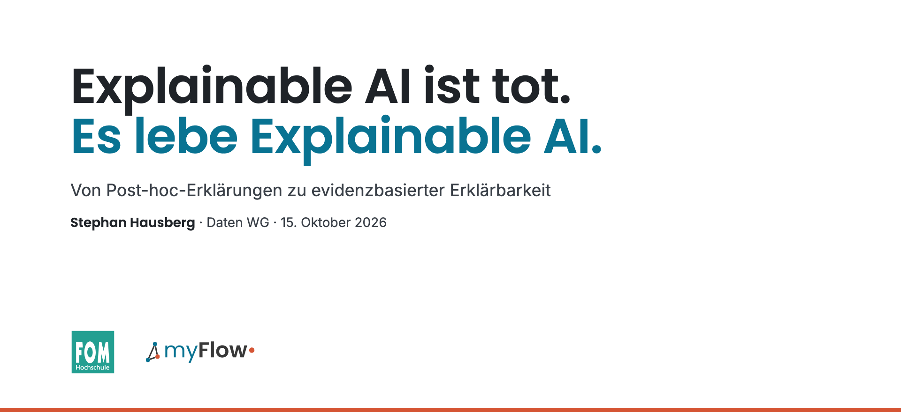

  

# Explainable AI ist tot. Es lebe Explainable AI.

*Von Post-hoc-Erklärungen zu evidenzbasierter Erklärbarkeit.* Vortrag von Stephan Hausberg (FOM Hochschule · myFlow Solutions) in der Daten WG am 15. Oktober 2026.

Post-hoc-Verfahren wie LIME und SHAP haben Erklärbarkeit populär gemacht. Mit Sprachmodellen stoßen sie an ihre Grenzen, und auch die Begründung, die ein Modell selbst ausgibt (Chain-of-Thought), ist keine verlässliche Erklärung. Gleichzeitig fragt der EU AI Act nicht mehr nur „warum?“, sondern „belegt?“.

Der Vortrag zeichnet diese Entwicklung als Folge von **Behauptung, Gegenbeweis und Erkenntnis** nach und schlägt vor, Erklärbarkeit als **Evidenz** zu verstehen: narrativ für Menschen, prüfbar für Audits, mit **Entscheidungsfragmenten** als kleinster prüfbarer Einheit einer Entscheidung.

## Folien

[`Explainable-AI-ist-tot_Folien_DE.pdf`](Explainable-AI-ist-tot_Folien_DE.pdf) – 33 Folien

## Literatur

- Adebayo, J. et al. (2018). Sanity Checks for Saliency Maps. *NeurIPS*.
- Bommasani, R. et al. (2021). On the Opportunities and Risks of Foundation Models. *arXiv:2108.07258*.
- Breiman, L. (2001). Statistical Modeling: The Two Cultures. *Statistical Science*.
- Jacovi, A. & Goldberg, Y. (2020). Towards Faithfully Interpretable NLP Systems. *ACL*.
- Karimi, A.-H. et al. (2020). Algorithmic Recourse: from Counterfactual Explanations to Interventions.
- Lipton, Z. C. (2018). The Mythos of Model Interpretability. *ACM Queue* 16(3).
- Lundberg, S. M. & Lee, S.-I. (2017). A Unified Approach to Interpreting Model Predictions. *NeurIPS*.
- Marx, C., Calmon, F. & Ustun, B. (2020). Predictive Multiplicity in Classification. *ICML*.
- Molnar, C. (2020). *Interpretable Machine Learning*.
- NIST (2023). *AI Risk Management Framework (AI RMF 1.0)*.
- Ribeiro, M. T., Singh, S. & Guestrin, C. (2016). „Why Should I Trust You?“ Explaining the Predictions of Any Classifier. *KDD*.
- Rudin, C. (2019). Stop Explaining Black Box Machine Learning Models for High Stakes Decisions and Use Interpretable Models Instead. *Nature Machine Intelligence*.
- Slack, D. et al. (2020). Fooling LIME and SHAP: Adversarial Attacks on Post hoc Explanation Methods. *AIES*.
- Turpin, M., Michael, J., Perez, E. & Bowman, S. R. (2023). Language Models Don't Always Say What They Think. *NeurIPS*.
- Wachter, S., Mittelstadt, B. & Russell, C. (2018). Counterfactual Explanations without Opening the Black Box. *Harvard Journal of Law & Technology*.
- Wei, J. et al. (2022). Chain-of-Thought Prompting Elicits Reasoning in Large Language Models. *NeurIPS*.
- Verordnung (EU) 2024/1689 (KI-Verordnung).
- Hausberg, S. From Post-hoc Explanations to Evidence-based Explainability: A Framework for Hybrid AI Systems under the EU AI Act. *Im Erscheinen.*

## Lizenz

© 2026 Stephan Hausberg. Folien und Texte stehen unter [CC BY 4.0](https://creativecommons.org/licenses/by/4.0/deed.de): Nutzung und Weitergabe mit Namensnennung.

**Ausgenommen:** Die Husky/Wolf-Abbildungen stammen aus Ribeiro et al. (2016) und sind als Zitat mit Quellenangabe enthalten, sie fallen nicht unter CC BY. Der Gehalts-Plot beruht auf dem Kaggle-Datensatz *Glassdoor – Analyze Gender Pay Gap*. Die Logos von FOM und myFlow sind Marken ihrer Inhaber und ebenfalls nicht lizenziert.

## Kontakt

Stephan Hausberg · [stephan.hausberg@fom-net.de](mailto:stephan.hausberg@fom-net.de) · [stephan@myflow-solutions.de](mailto:stephan@myflow-solutions.de)
